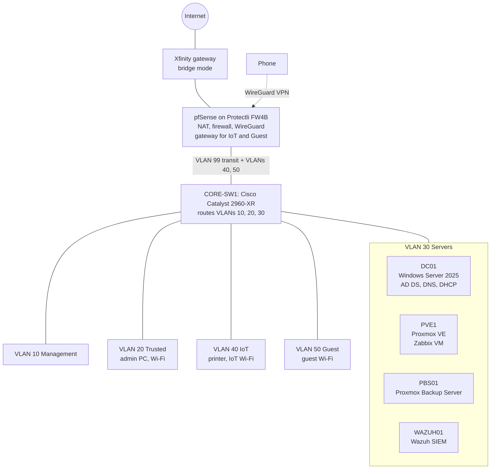
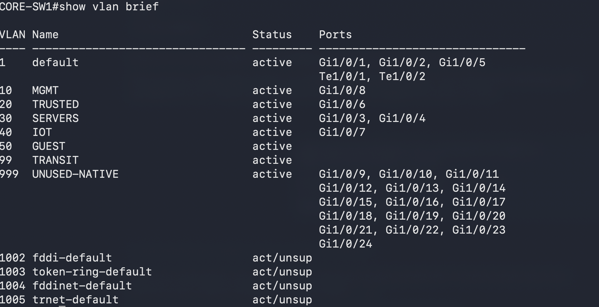
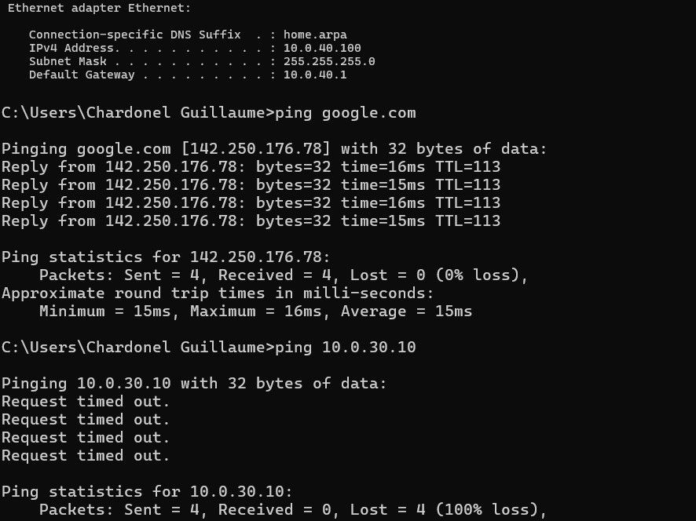
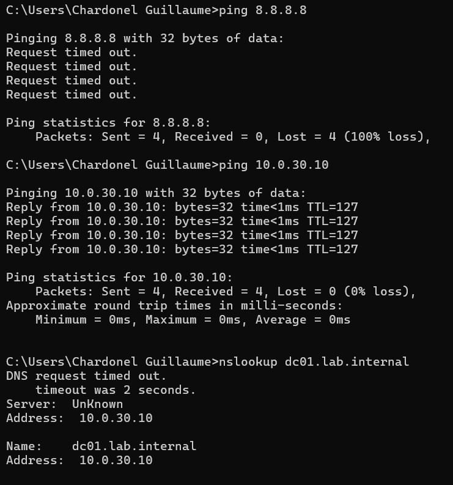
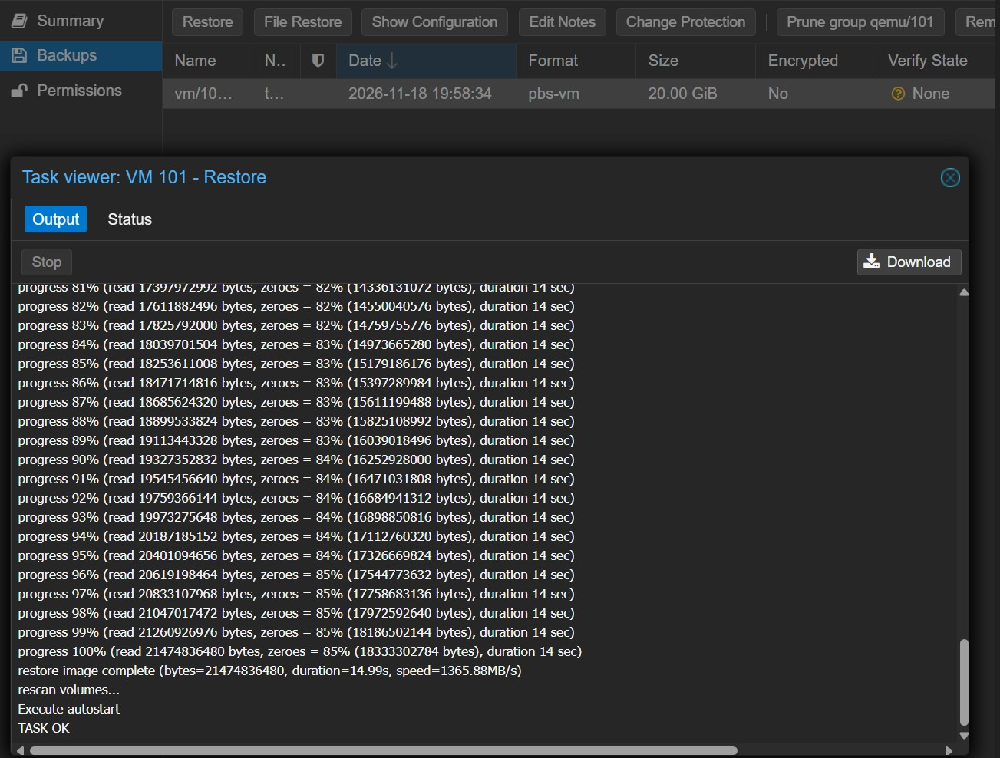
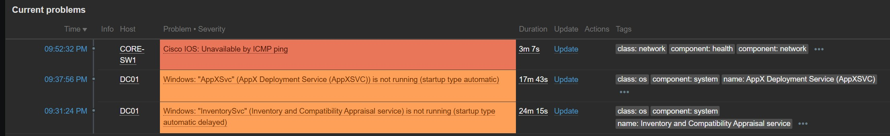
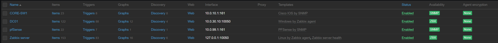
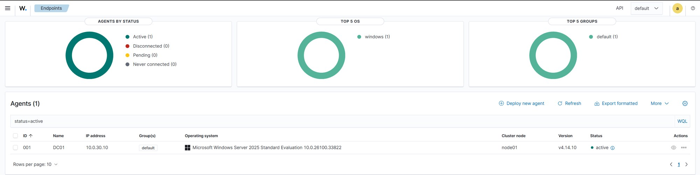
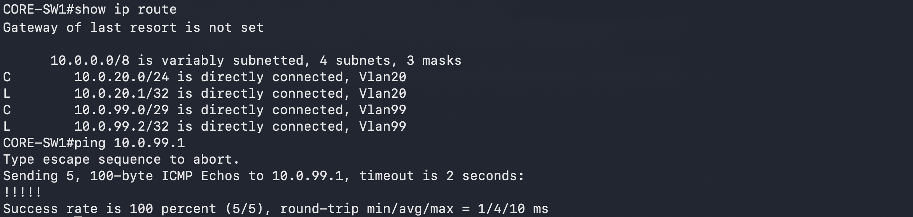

# Home Lab: Network and Systems

I'm Chardonel Guillaume, a CCNA-certified IT support and network tech (also Network+, Security+, AZ-900) working toward my first NOC or help desk role. I built this lab under my desk to do the real work: set things up, monitor them, break them on purpose, and fix them.

**Built:** Oct 2026 to present · **LinkedIn:** [linkedin.com/in/chardonelguillaume](https://www.linkedin.com/in/chardonelguillaume)

## At a glance

- 5 VLANs plus a transit link: a Cisco Catalyst 2960-XR routes the internal ones, and pfSense guards the edge, IoT and Guest
- Windows Server 2025 domain controller running AD, DNS and DHCP
- Proxmox host, plus Proxmox Backup Server with nightly backups and a tested restore (20 GiB back in 15 seconds)
- Zabbix watching the firewall, switch and domain controller over SNMPv3 and agents, and a Wazuh SIEM collecting from the domain controller
- WireGuard VPN so I can reach the lab from my phone
- Break-tested: firewall down, domain controller down, DHCP relay removed

## Hardware

| Device | Name | Role |
|---|---|---|
| Protectli Vault FW4B | pfSense | Edge firewall: NAT, firewall rules, WireGuard, gateway for IoT and Guest |
| Cisco Catalyst 2960-XR (24-port PoE+) | CORE-SW1 | Core switch: VLANs, inter-VLAN routing, ACLs, PoE for the access point |
| Dell OptiPlex 3060 Micro | DC01 | Windows Server 2025: AD DS, DNS, DHCP |
| Dell OptiPlex 3070 Micro | PVE1 | Proxmox VE, runs the Zabbix VM (ZBX01) |
| Dell OptiPlex 3060 Micro | PBS01 | Proxmox Backup Server |
| Dell OptiPlex 3070 Micro | WAZUH01 | Ubuntu 24.04 + Wazuh SIEM |
| TP-Link Omada EAP650 | AP | Wi-Fi 6, separate networks for Trusted, IoT and Guest |

## Network diagram

## VLANs

| VLAN | Name | Subnet | Routed by | Addresses |
|---|---|---|---|---|
| 10 | Management | 10.0.10.0/24 | Cisco switch | Static |
| 20 | Trusted | 10.0.20.0/24 | Cisco switch | DHCP from DC01, relayed by the switch |
| 30 | Servers | 10.0.30.0/24 | Cisco switch | Static |
| 40 | IoT | 10.0.40.0/24 | pfSense | DHCP from pfSense |
| 50 | Guest | 10.0.50.0/24 | pfSense | DHCP from pfSense |
| 99 | Transit | 10.0.99.0/29 | Link between pfSense and the switch | Static |

Why it's split this way: the switch routes the internal VLANs at full speed, and IoT and Guest use pfSense as their gateway so its firewall rules decide what they can reach. I never put IoT or Guest interfaces on the switch, because that would let them skip the firewall.

---

## Project 1: Segmented network + VPN

**Goal:** keep IoT and guest devices away from my servers, let only my admin PC manage the gear, and reach the lab safely from anywhere.

**What I built**
- pfSense on the FW4B with a trunk to the switch carrying VLANs 40, 50 and 99, plus DHCP for IoT and Guest.
- Inter-VLAN routing on the Cisco with SVIs for VLANs 10, 20 and 30, a default route to pfSense over VLAN 99, and static routes back from pfSense.
- Firewall rules: IoT and Guest get DNS and internet only, and they're blocked from the firewall and every private network. The transit rules only allow what I actually use, and they replaced the temporary allow-all rule.
- Switch ACLs: only my admin PC can reach the Management VLAN, and SSH to the switch only works from that PC.
- WireGuard on pfSense as a split tunnel to the lab networks, tested from my phone on 5G.
- Put the Xfinity gateway in bridge mode to get rid of double NAT. The WAN has averaged 0.04% packet loss since.
- Trunked the access point so each Wi-Fi network lands on its own VLAN.

**Proof**

*CORE-SW1: every VLAN in place.*

*From the IoT VLAN: the internet works, but the domain controller (10.0.30.10) times out. That's the point.*

**Break tests:** I took things down one at a time and wrote down what failed and what kept running.

| What I took down | What broke | What kept working |
|---|---|---|
| pfSense | Internet, VPN, IoT and Guest, printing from Trusted | Everything inside: AD, DNS, Proxmox, monitoring. The switch routes internal traffic by itself |
| DC01 | Name lookups and DHCP renewals | Internet by IP (8.8.8.8). PCs kept their addresses until their leases run out |
| DHCP relay (ip helper-address) | A PC on VLAN 20 couldn't get an address back | Everything else. Putting the helper line back fixed it |

*pfSense unplugged: 8.8.8.8 times out, but DC01 still answers and DNS still works.*

Side finding: my phone's VPN uses DC01 for DNS, so when the lab went down the phone couldn't look anything up until I turned the tunnel off.

**What I'd do at a real company:** two firewalls in high availability instead of one box, and change control before touching rules on a live network.

## Project 2: Backups + monitoring

**Goal:** know when something goes down, and be able to get it back.

**What I built**
- Proxmox Backup Server on PBS01 with a 500 GB datastore that keeps 7 daily and 4 weekly backups, plus daily garbage collection and verify jobs.
- A backup-only account for Proxmox (DatastoreBackup role). It can back up and restore but can't delete, so a compromised host can't wipe the backups.
- A nightly 2 AM backup job for every VM.
- An Ubuntu 24.04 cloud-init template, so new VMs come up with my SSH key and the guest agent already set.
- Zabbix 7.0 LTS on ZBX01 monitoring DC01 (Zabbix agent 2, with the firewall port open to Zabbix only), CORE-SW1 (SNMPv3 with auth and encryption, limited by ACL to the Zabbix server) and pfSense (SNMP on the transit interface).

**The restore test:** I wrote a marker file on a test VM, backed it up, deleted the VM, and restored it. All 20 GiB came back in 14.99 seconds with the marker file still there.

*Restore task: 14.99 s, TASK OK.*

**Zabbix's first real alert was my own fault.** The switch showed as down by ping, but SNMP data was still coming in, so the switch was fine and something was blocking ping. My ACL only allowed SNMP from the Servers VLAN to Management. I added one line that permits ping from the Zabbix server only. I also tuned out false alerts from Windows services that only start on demand.

*The alert: CORE-SW1 unavailable by ICMP ping.*

*After the fix: the switch and pfSense green over SNMP, DC01 and the Zabbix server green over the agent.*

**What I'd do at a real company:** keep an offline or offsite copy of the backups (3-2-1), send alerts to email or Teams with an on-call rotation, and use SNMPv3 everywhere.

## Project 3: Active Directory domain

**Goal:** run the services every office depends on: logins, DNS and DHCP.

**What I built**
- DC01 on Windows Server 2025 (Desktop Experience) with a static IP, promoted to a new forest, lab.internal, with DNS and DHCP.
- DNS forwarders to 1.1.1.1 and 9.9.9.9, and domain time synced from public NTP servers.
- A DHCP scope for the Trusted VLAN with reservations. DC01 sits on a different VLAN, so the switch relays DHCP to it with ip helper-address.
- The Wazuh agent on DC01, sending its logs to WAZUH01.

*Wazuh: DC01 checked in as an active agent.*

**What I'd do at a real company:** a second domain controller. The DC01 break test showed it's a single point of failure for DNS and DHCP.

---

## What broke and how I fixed it

| Problem | How I proved it | Fix |
|---|---|---|
| PC reached its gateway but had no internet | `show ip route` showed no gateway of last resort. The default route got dropped while I pasted config over a 9600-baud console | Re-added the default route, and tracert came out clean |
| DHCP handed out a 255.0.0.0 mask | `ipconfig /all` on the PC | The scope wizard pre-fills /8 for 10.x addresses. Rebuilt the scope as /24 |
| IoT test device got no IP | `show interfaces status` and the trunk showed the switch was set up right | pfSense's DHCP server on the IoT interface was off. Turned it on |
| Zabbix said the switch was down | SNMP data was still flowing, so the switch was up | My own ACL blocked ping. Added a one-line ICMP permit for the Zabbix server |
| PBS01 unreachable after install | The console banner showed 10.30.0.7 instead of 10.0.30.7 | Fixed the typo in the network config and hosts file |
| Proxmox updates failed | `apt update` returned 401 from the paid enterprise repo | Disabled it and switched to the free repo |
| Typos in the Zabbix config files | `grep -c` and `nginx -t` caught each one | Fixed each line before starting the services |

*Before the fix: "Gateway of last resort is not set," even though pfSense answers ping.*

## What's next

- Help desk tickets in AD: OUs, users, groups, password resets, account lockouts and GPOs
- A Windows 11 client joined to the domain
- Zabbix alerts sent to my phone
- A second domain controller
- An offline copy of the backups
- OSPF between the switch and pfSense
